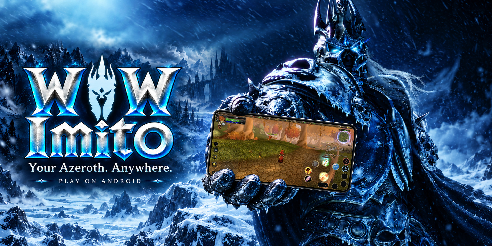
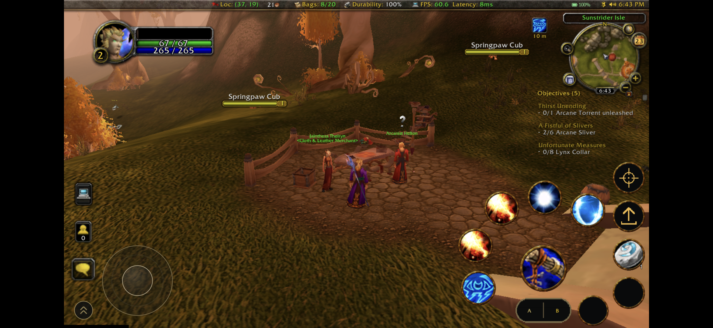
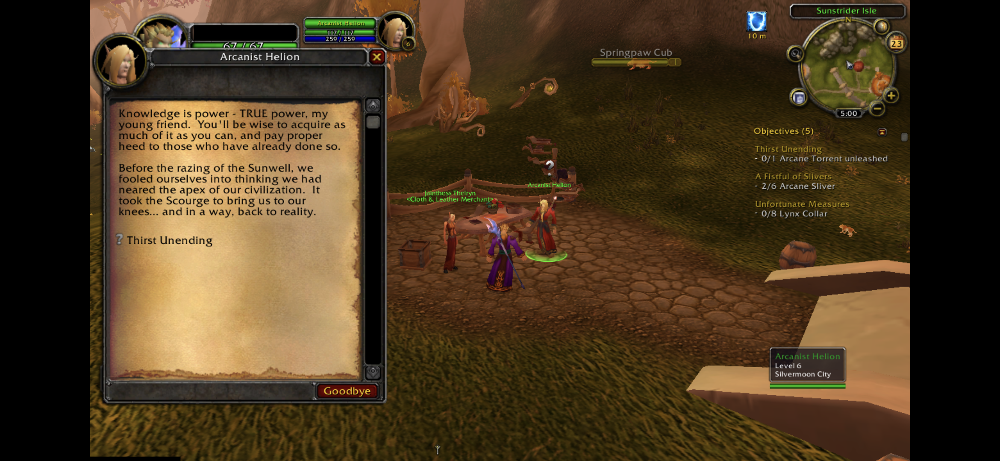
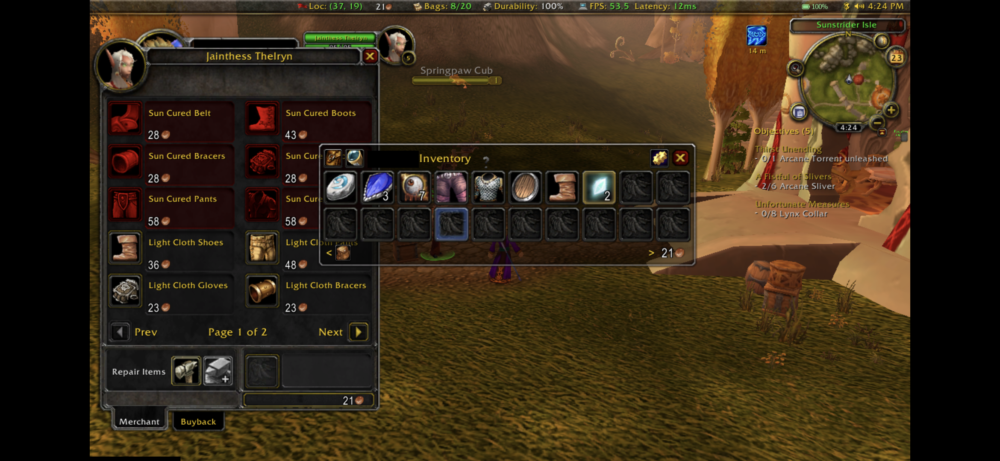

> [!IMPORTANT]
> **Please send bugs and requests through the app: Settings > Game crash report > Report a problem.**
> This gives info about the device and game details needed to investigate faster and keeps your report properly tracked.
> For **feature requests, support for another device or another client**, choose **Other** and describe your request before sending.
> If the app cannot open, [create a GitHub issue](https://github.com/MrAnonymz/WoW-Imito/issues/new/choose) instead.

# WoW Imito

**Your Azeroth. Your character. Now on Android.**

Play **World of Warcraft — Vanilla, The Burning Crusade and Wrath of the Lich King** on your **Android phone or tablet**, on the **same server as your friends on PC**. Explore, quest and play together with **touchscreen or controller controls** — no PC needed while you play.

**[Download APK](https://github.com/MrAnonymz/WoW-Imito/releases/latest)** · **[Release notes](https://github.com/MrAnonymz/WoW-Imito/releases)** · **[Community reports](https://github.com/MrAnonymz/WoW-Imito/issues)**

## Start playing

**You need Android 12 or newer, an ARM64 processor with 64-bit Android, and your own complete compatible WoW client.**

1. **Install** the APK and open WoW Imito.
2. Copy your client to your phone or SD card, or use **Game files** to download it from a ZIP link.
3. The app **finds your clients automatically**. Choose one and **confirm or change the server address** when prompted.
4. Tap **PLAY**, sign in inside WoW and choose your character.

You can still select a folder in **Game files** or change your server in **Settings > Set realm**.

<strong>Requirements & storage</strong>

> **Android 12 or newer + ARM64 with 64-bit Android are required.** Bring the **complete client required by your server** and check the free storage below before installing.

| Component | Requirement / recommendation |
| :--- | :--- |
| **Android** | **12 or newer** |
| **Architecture** | **ARM64 processor + 64-bit Android** |
| **CPU performance** | Suggested starting point: **Snapdragon 888 class or better** |
| **Memory** | **6 GB RAM** suggested minimum · **8 GB+** recommended |
| **Storage — Vanilla / TBC** | About **8 GB / 12 GB free** before installation |
| **Storage — standard WotLK** | About **22 GB free** before installation |
| **Storage — Wrath Rebuffed** | About **30 GB free** before installation |
| **Storage — tested CoA client** | About **50 GB free** before installation |
| **Game files** | Your own complete **Vanilla 1.12.1**, **TBC 2.4.3** or **WotLK 3.3.5a** client |
| **Connection** | Internet access and an account on your chosen compatible server |

The APK does not include game files or a server account. Storage needs depend on your client. CPU and RAM figures are recommendations; slower devices may run at reduced FPS.

> [!TIP]
> **ECO mode is strongly recommended for longer play sessions.** It limits the game to **40 FPS**, reducing CPU/GPU workload and helping your battery last longer. The benefit varies by device and settings. **Low specs** can also help on slower devices.

## Compatibility & features

Select a section to see the details.

<strong>Supported & tested clients</strong>

| Client | In-game testing | Game updates |
| :--- | :--- | :--- |
| **WoW Vanilla 1.12.1** | ✅ Tested on a local test realm | Use your server's usual update method |
| **The Burning Crusade 2.4.3** | ✅ Tested on a local test realm | Use your server's usual update method |
|  **Standard WoW WotLK 3.3.5a** | ✅ Tested, including Warmane WotLK | Use your server's usual update method |
|  **CoA / Descension community client** | ✅ Tested on a local test realm | Direct updates in WoW Imito |
|  **Wrath Rebuffed** | ✅ Tested | Direct updates in WoW Imito |
|  **Project Epoch Reborn (3.3.5a)** | ✅ Tested | Direct updates in WoW Imito |
| **Grimfall client (3.3.5a)** | ✅ Tested | Direct updates in WoW Imito |

> Use the **complete client required by your server**. The CoA entry refers to the **community distribution**, not a confirmed test of the official Ascension service. Other modified clients may need additional compatibility work.

For **Wrath Rebuffed**, try **Settings > Text rendering > Original WoW** for performance. Standard WotLK and CoA / Descension need no change here.

<strong>Supported & confirmed devices</strong>

> WoW Imito targets **Android 12+ with ARM64 and 64-bit Android**. The check marks below confirm successful **in-game testing**, not a guarantee of 60 FPS. Other devices may work too.

| Device | Confirmed working |
| :--- | :---: |
| **Samsung Galaxy S26 (SM-S942B)** | ✅ |
| **Samsung Galaxy S21 FE (SM-G990B2)** | ✅ |
| **Samsung Galaxy S23 Ultra** | ✅ |
| **Motorola Edge 70 Max** | ✅ |
| **AYN Odin 2** | ✅ |

**[Confirm your device](https://github.com/MrAnonymz/WoW-Imito/issues/new?template=device-confirmation.yml)** to help grow this list. For problems or requests to support another device, use the **in-app report** described at the top of this page.

<strong>FPS tests — 1280 × 720 (HD)</strong>

Average FPS with **low graphics settings**:

| Client version | Samsung S26 | Samsung S21 FE |
| :--- | ---: | ---: |
| **WoW Vanilla 1.12.1** | **~60 FPS** | **~60 FPS** |
| **The Burning Crusade 2.4.3** | **~60 FPS** | **~56 FPS** |
| **Standard WoW WotLK 3.3.5a** | **~60 FPS** | **~51 FPS** |
| **CoA / Descension** | **~60 FPS** | — |
| **Wrath Rebuffed** | **~60 FPS** | — |
| **Project Epoch Reborn (3.3.5a)** | **~60 FPS** | **~52 FPS** |
| **Grimfall client (3.3.5a)** | **~60 FPS** | — |

> FPS was measured in **starting locations**. Crowded cities such as **Dalaran, Orgrimmar and Stormwind** may run at lower FPS. These are **measured averages, not guaranteed minimums**. **—** means not tested on that device.

Wrath Rebuffed used **Original WoW** text rendering. CoA / Descension was tested on a local test realm.

**Performance varies by device:** CPU, GPU, RAM, resolution, graphics settings, enabled addons, temperature, battery level and power-saving mode can all affect FPS. Further performance optimizations are in active development.

<strong>Included addons & controls</strong>

> The app includes addons **compatible with your client version**. Availability differs between Vanilla, TBC and Wrath. These optional addons are **OFF by default**; enable the ones you want in **AddOns** on the character-selection screen.

| Addon | What it adds |
| :--- | :--- |
| **Bagnon** | All your bags in one window |
| **ConsolePort** | Controller interface and configurable bindings |
| **LoseControl** | Crowd-control effects and their duration |
| **NotPlater** | Customisable nameplates |
| **OmniCC** | Cooldown timers on your spells |
| **Titan Panel** | Information bar with battery percentage and FPS |
| **Immersion** | A new look for quest and NPC conversations |
| **AtlasLoot Enhanced** | Dungeon, raid and other loot tables |
| **GearScoreLite** | Equipment scores |
| **Deadly Boss Mods** | Boss warnings and timers |
| **SexyMap** | Minimap customisation |
| **X-Perl UnitFrames** | Alternative player, target and party frames |

**MoveAnything** and **MinimapButtonBag** are **ON by default** to help arrange the interface and organise minimap buttons. After changing addon activation while playing, type **`/reload`** to apply it.

On **Wrath**, choose **WoW Imito Touch UI** or **ConsolePort**, and keep **WoW Imito Input** enabled. The two interfaces are mutually exclusive. Connecting or disconnecting a controller does not automatically enable ConsolePort or change your selection. Vanilla and TBC use their own compatible **WoW Imito Touch UI** addon.

<strong>Updating your game</strong>

> For supported clients, **PLAY** checks for updates automatically. Choose **Update** when prompted, or check manually in **Settings > Update game**.

- **Project Epoch Reborn** and the **CoA / Descension community client** download updates directly in the app.
- **Wrath Rebuffed** and **Grimfall** update directly in WoW Imito.
- Downloads can continue **in the background** and **resume after an interruption**.
- Your **graphics settings, addons and server address** are preserved.

Other clients still use their existing update method.

## Gameplay screenshots

---

Maintained by **Mr Anonymz**. Unofficial community project, not affiliated with Blizzard Entertainment or the listed servers. [Third-party credits and licences](THIRD-PARTY-NOTICES.txt) · [Logo credits](assets/clients/CREDITS.txt).
