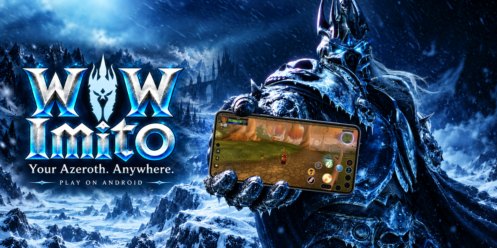
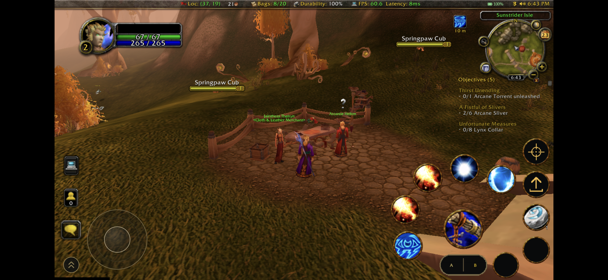
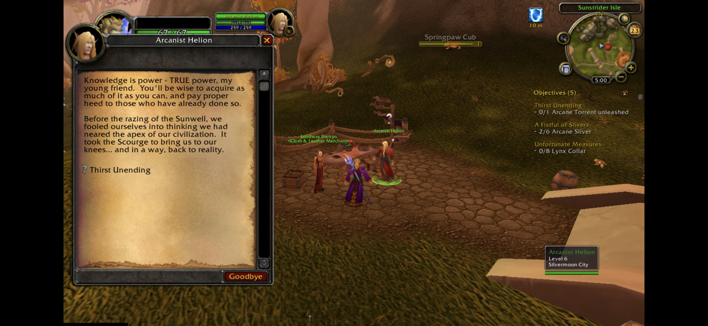
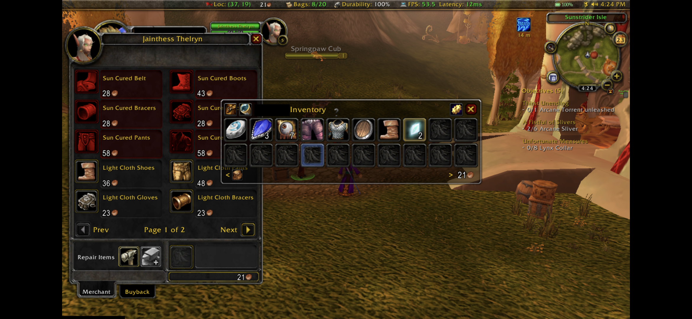

  If you like my work, buy me a coffee, it will help me keep the development active.

  BUY ME A COFFEE

  Link:

  https://buy.stripe.com/fZu7sM8Gm4UA2XGaOIbII01

   QR:

  

<stripe-buy-button
  buy-button-id="buy_btn_1UaFZUJfGJvPeUMg8xLAqJ15"
  publishable-key="pk_live_51UZGYpJfGJvPeUMgDNm7JXSqBiG0CJMgRa12H9oyIE1B3NYndBAmXL5eudGGMeofwAh9wH9qUl4aymGWno3PYn1V00RjmC4uYf"
>
</stripe-buy-button>

> [!IMPORTANT]
> **Please send bugs and requests through the app: Settings > Report problem.**
> This gives info about the device and game details needed to investigate faster and keeps your report properly tracked.
> For **feature requests, support for another device or another client**, choose **Other** and describe your request before sending.
> If the app cannot open, [create a GitHub issue](https://github.com/MrAnonymz/WoW-Imito/issues/new/choose) instead.

# WoW Imito

**Your Azeroth. Your character. Now on Android.**

Play **World of Warcraft — Vanilla, The Burning Crusade and Wrath of the Lich King** on your **Android phone or tablet**, on the **same server as your friends on PC**. Explore, quest and play together with **touchscreen or controller controls** — no PC needed while you play.

**[Download APK](https://github.com/MrAnonymz/WoW-Imito/releases/latest)** · **[Release notes](https://github.com/MrAnonymz/WoW-Imito/releases)** · **[Community reports](https://github.com/MrAnonymz/WoW-Imito/issues)**

## Start playing

**You need Android 12 or newer, an ARM64 processor with 64-bit Android, and your own complete compatible WoW client.**

1. **Install** the APK and open WoW Imito.
2. Copy your client to your phone or SD card, or use **Game files** to download it from a ZIP link.
3. The app **finds your clients automatically**. Choose one and **confirm or change the server address** when prompted.
4. Tap **PLAY**, sign in inside WoW and choose your character.

You can still select a folder in **Game files** or change your server in **Settings > Set realm**.

**App updates are offered automatically.** From version **1.3.3 onward**, supported updates download only the changed parts, even if you skipped releases.

Enable **Options > Support > Automatically update WoW Imito** for automatic downloads and installation from the launcher. Android may request installation permission or confirmation.

Tap **WoW Imito** or the **version number** at the bottom left of the launcher to read the installed version's release notes offline.

**New to touch controls?** Open **Menu > Touch UI > Show tutorial** for the interactive guide.

In **Touch UI**, move controls or tap one to change its individual size. Choose **Save & reload** to keep your layout. To keep a small chat visible while playing, open **Chat** and turn **Pin** on.

<strong>Requirements & storage</strong>

**Android 12 or newer + ARM64 with 64-bit Android are required.** Bring the **complete client required by your server** and check the free storage below before installing.!

| Component | Requirement / recommendation |
| :--- | :--- |
| **Android** | **12 or newer** |
| **Architecture** | **ARM64 processor + 64-bit Android** |
| **CPU performance** | Suggested starting point: **Snapdragon 888 class or better** |
| **GPU performance** | **Compatible GPU with a functional Vulkan driver** |
| **Memory** | **6 GB RAM** suggested minimum · **8 GB+** recommended |
| **Storage — Vanilla / TBC** | About **8 GB / 12 GB free** before installation |
| **Storage — standard WotLK** | About **22 GB free** before installation |
| **Storage — Wrath Rebuffed** | About **30 GB free** before installation |
| **Storage — tested CoA client** | About **50 GB free** before installation |
| **Game files** | Your own complete **Vanilla 1.12.1**, **TBC 2.4.3** or **WotLK 3.3.5a** client |
| **Connection** | Internet access and an account on your chosen compatible server |

The APK does not include game files or a server account. Storage needs depend on your client. CPU and RAM figures are recommendations; slower devices may run at reduced FPS.

> [!TIP]
> **ECO mode is strongly recommended for longer play sessions.** Choose **30, 40, 50 or 60 FPS** to reduce CPU/GPU workload and help your battery last longer. The benefit varies by device and settings. **Low specs** can also help on slower devices.

## Compatibility & features

Select a section to see the details.

<strong>Supported & tested clients</strong>

| Client | In-game testing | Game updates |
| :--- | :--- | :--- |
| **WoW Vanilla 1.12.1** | ✅ Tested on a local test realm | Use your server's usual update method |
| **The Burning Crusade 2.4.3** | ✅ Tested on a local test realm | Use your server's usual update method |
|  **Standard WoW WotLK 3.3.5a** | ✅ Tested, including Warmane WotLK | Use your server's usual update method |
|  **CoA / Descension community client** | ✅ Tested on a local test realm | Direct updates in WoW Imito |
|  **Wrath Rebuffed** | ✅ Tested | Direct updates in WoW Imito |
|  **Project Epoch Reborn (3.3.5a)** | ✅ Tested | Direct updates in WoW Imito |
| **Grimfall client (3.3.5a)** | ✅ Tested | Direct updates in WoW Imito |
| **OctoWoW (Vanilla)** | Tested in game | Direct updates in WoW Imito |
| **Triumvirate (3.3.5a)** | Tested in game | Direct updates in WoW Imito |

> Use the **complete client required by your server**. The CoA entry refers to the **community distribution**, not a confirmed test of the official Ascension service. Other modified clients may need additional compatibility work.

For **Wrath Rebuffed**, try **Settings > Text rendering > Original WoW** for performance. Standard WotLK and CoA / Descension need no change here.

<strong>Supported & confirmed devices</strong>

> WoW Imito targets **Android 12+ with ARM64 and 64-bit Android**. The check marks below confirm successful **in-game testing**, not a guarantee of 60 FPS. Other devices may work too.

| Device | Confirmed working |
| :--- | :---: |
| **Samsung Galaxy S26 (SM-S942B)** | ✅ |
| **Samsung Galaxy S21 FE (SM-G990B2)** | ✅ |
| **Samsung Galaxy S23 Ultra** | ✅ |
| **Samsung Galaxy S26 Ultra** | ✅ |
| **Motorola Edge 70 Max** | ✅ |
| **AYN Odin 2** | ✅ |
| **POCO X7 Pro** | ✅ |
| **Google Pixel 10 Pro XL** | ✅ |

**[Confirm your device](https://github.com/MrAnonymz/WoW-Imito/issues/new?template=device-confirmation.yml)** to help grow this list. For problems or requests to support another device, use the **in-app report** described at the top of this page.

The Pixel 10 Pro XL confirmation used the player's custom graphics settings.

<strong>FPS tests — 1280 × 720 (HD)</strong>

**WoW Imito 1.4.1 · Low graphics**

**FPS: standing / camera movement**

| Client | S21 | S26 |
| --- | --- | --- |
| Vanilla 1.12.1 | 105.5 / 75.5 | 174.5 / 128.5 |
| The Burning Crusade 2.4.3 | 102 / 77.5 | 191 / 120 |
| Wrath of The Lich King 3.3.5a | — | 135.5 / 123 |
| Wrath 3.3.5a (Warmane) | — | 110.5 / 84 |
| Wrath Rebuffed | — | 100.5 / 73 |
| Grimfall | — | 150 / 117 |
| Project Epoch Reborn | — | 95.5 / 84 |
| OctoWoW | 102 / 92 | 163.5 / 124.5 |
| Triumvirate | — | 177.5 / 133 |
| CoA / Descension | — | 102 / 86.5 |

**Performance varies by device:** CPU, GPU, RAM, resolution, graphics settings, enabled addons, temperature, battery level and power-saving mode can all affect FPS.

<strong>Included addons & controls</strong>

> The app includes addons **compatible with your client version**. Availability differs between Vanilla, TBC and Wrath. These optional addons are **OFF by default**; enable the ones you want in **AddOns** on the character-selection screen.

| Addon | What it adds |
| :--- | :--- |
| **Bagnon** | All your bags in one window |
| **ConsolePort** | Controller interface and configurable bindings |
| **LoseControl** | Crowd-control effects and their duration |
| **NotPlater** | Customisable nameplates |
| **OmniCC** | Cooldown timers on your spells |
| **Titan Panel** | Information bar with battery percentage and FPS |
| **Immersion** | A new look for quest and NPC conversations |
| **AtlasLoot Enhanced** | Dungeon, raid and other loot tables |
| **GearScoreLite** | Equipment scores |
| **Deadly Boss Mods** | Boss warnings and timers |
| **SexyMap** | Minimap customisation |
| **X-Perl UnitFrames** | Alternative player, target and party frames |

**MoveAnything** and **MinimapButtonBag** are **ON by default** to help arrange the interface and organise minimap buttons. After changing addon activation while playing, type **`/reload`** to apply it.

On **Wrath**, choose **WoW Imito Touch UI** or **ConsolePort**, and keep **WoW Imito Input** enabled. The two interfaces are mutually exclusive. Connecting or disconnecting a controller does not automatically enable ConsolePort or change your selection. Vanilla and TBC use their own compatible **WoW Imito Touch UI** addon.

Open **Touch UI** in the in-game menu to resize or move controls and choose the optional **4-way turn joystick**. The original joystick is the default. Use **W/R** to switch between walking and running.

**New to touch controls?** Choose **Show tutorial** when prompted, or start it from **Touch UI**. Follow the highlighted controls to learn movement, spells, items, macros and custom layouts by trying them yourself.

<strong>Updating your game</strong>

> For supported clients, **PLAY** checks for updates automatically. Choose **Update** when prompted, or open **Settings** and use **Update** followed by your selected client's name.

- **Project Epoch Reborn** and the **CoA / Descension community client** download updates directly in the app.
- **Wrath Rebuffed** and **Grimfall** update directly in WoW Imito.
- Downloads can continue **in the background** and **resume after an interruption**.
- Your **graphics settings, addons and server address** are preserved.

Standard Vanilla, TBC and Wrath clients use your server's usual update method. Their **Update** button in Options is disabled.

## Gameplay screenshots

---

Maintained by **Mr Anonymz**. Unofficial community project, not affiliated with Blizzard Entertainment or the listed servers. [Third-party credits and licences](THIRD-PARTY-NOTICES.txt) · [Logo credits](assets/clients/CREDITS.txt).
